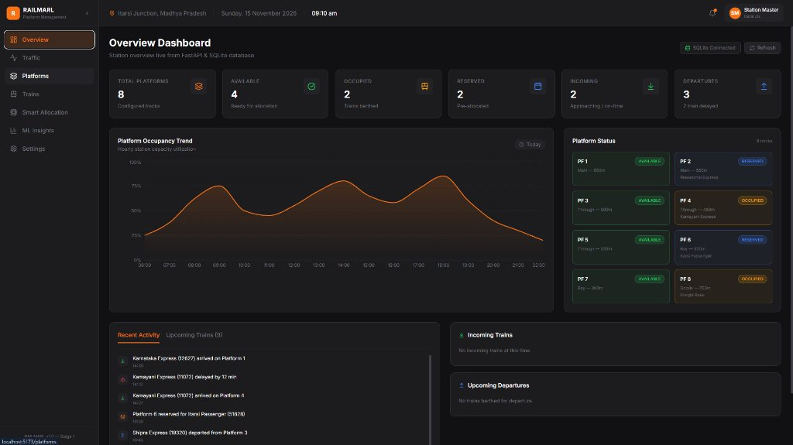
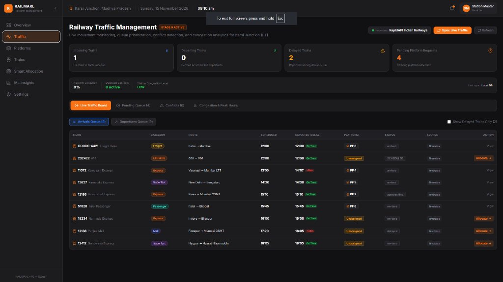
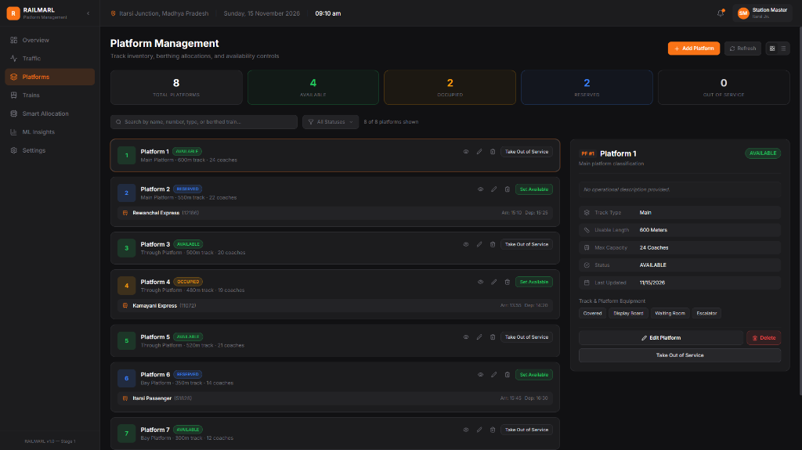
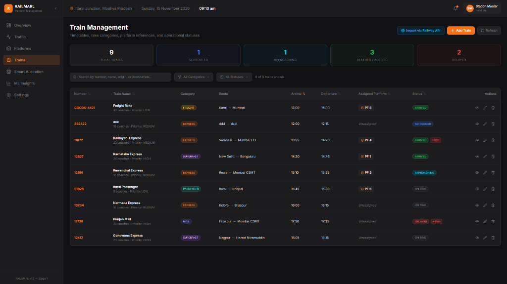
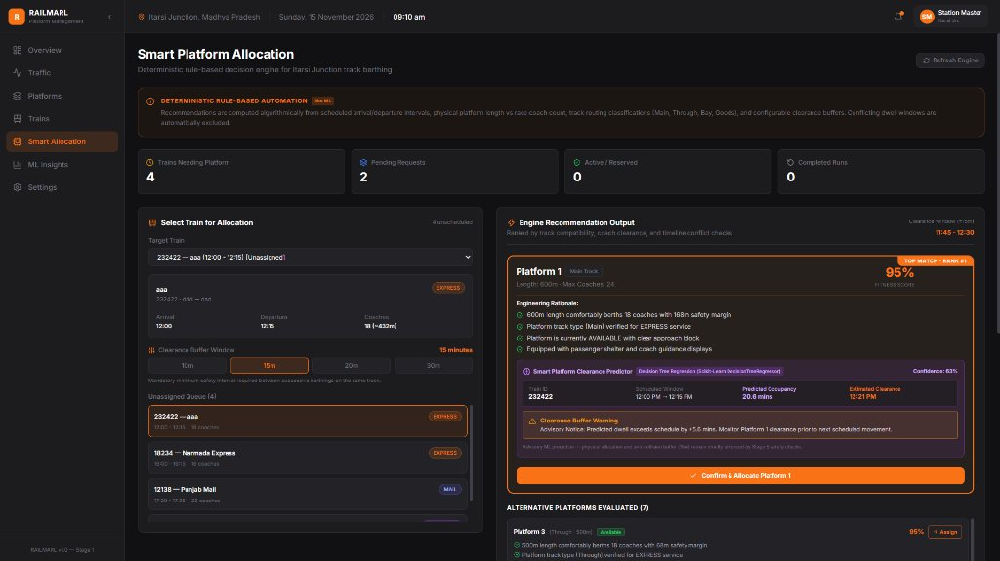
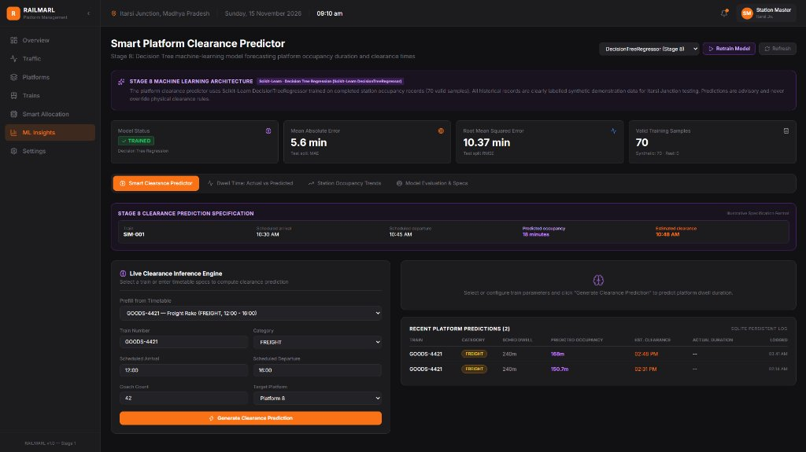
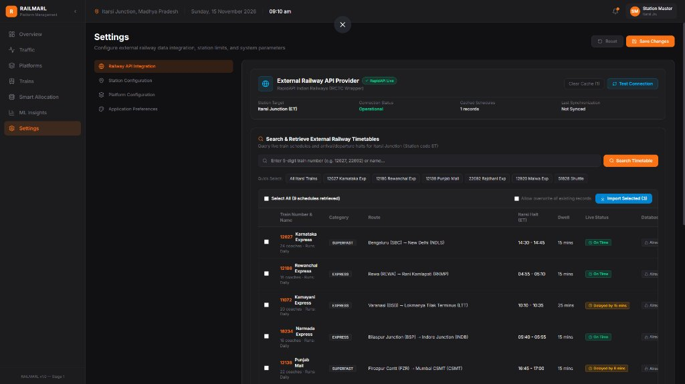

# RAILMARL: Itarsi Junction Platform Management & Traffic Control System

Operational platform management dashboard, railway traffic monitoring, machine learning platform clearance duration predictor, external Indian Railway API integration, and FastAPI backend with SQLite for Itarsi Junction (Madhya Pradesh).

---

## Output Showcase

Screenshots of the implemented RAILMARL system operating with live telemetry and machine learning models for Itarsi Junction:

### 1. Overview Dashboard

*Real-time station status, hourly platform occupancy trend curve, active platform cards, and recent train arrival/departure activity feed.*

### 2. Railway Traffic Management (Stage 9)

*Live traffic arrivals and departures board, reported delay tracking (+12m, +45m), multi-factor queue prioritization, conflict alerts, and 24-hour congestion analytics.*

### 3. Platform Inventory & Track Infrastructure

*Track inventory for Platforms 1 through 8 at Itarsi Junction, displaying track classifications (Main, Through, Bay, Goods), usable lengths (meters), coach limits, and operational equipment.*

### 4. Train Schedules & Timetable Management

*Active timetables, rake categories (Superfast, Express, Mail, Passenger, Freight), arrival and departure halts, dwell durations, and assigned platform berths.*

### 5. Smart Platform Allocation & Safety Buffer Engine

*Algorithmic recommendation engine ranking Platform 1 (95% fitness score), buffer warning notices, and integrated DecisionTree clearance forecast.*

### 6. Machine Learning Platform Clearance Predictor (Stages 6 & 8)

*Trained Scikit-Learn DecisionTreeRegressor metrics (MAE 5.6 min, RMSE 10.37 min, 70 training samples), live clearance inference engine, and persistent prediction logs.*

### 7. External Railway API Integration (Stage 7)

*Settings panel showing RapidAPI and RailRadar connectivity, in-memory TTL cache management, train timetable search, and selective import into the local schedule.*

---

## System Design Architecture

```
                          +----------------------------------------------------+
                          |               Web Client (Browser)                 |
                          |  React 19 + TypeScript + Vite + Tailwind CSS       |
                          +-------------------------+--------------------------+
                                                    |
                                       HTTP / REST (JSON API)
                                                    v
+------------------------------------------------------------------------------------------------------+
|                                   FastAPI Application (Port 8000)                                   |
|                                                                                                      |
|  +--------------------+  +---------------------+  +--------------------+  +----------------------+   |
|  |  Platforms Router  |  |    Trains Router    |  | Allocation Router  |  |   Traffic Router     |   |
|  |  CRUD & Equipment  |  | Timetables & Status |  | Rule Engine / Recs |  | Live Boards & Queues |   |
|  +---------+----------+  +----------+----------+  +---------+----------+  +----------+-----------+   |
|            |                        |                       |                        |               |
|  +---------+------------------------+-----------------------+------------------------+------------+  |
|  |                                  Domain & Service Layer                                        |  |
|  |                                                                                                |  |
|  |  +---------------------------+  +---------------------------+  +----------------------------+  |  |
|  |  |  Smart Allocation Engine   |  |   ML Clearance Predictor  |  |  Traffic Monitoring Engine |  |  |
|  |  | - Physical length check   |  | - DecisionTreeRegressor   |  | - Delay tracking (delays)  |  |  |
|  |  | - Track type matching     |  | - Dwell forecast (minutes)|  | - Queue priority ranking   |  |  |
|  |  | - Headway buffer scoring  |  | - 12h AM/PM clearance calc|  | - Schedule conflict alerts |  |  |
|  |  | - Double-booking reject   |  | - Joblib model store      |  | - 24h density analytics   |  |  |
|  |  +---------------------------+  +---------------------------+  +----------------------------+  |  |
|  |                                                                                                |  |
|  |  +------------------------------------------------------------------------------------------+  |  |
|  |  |                         External Railway API Coordinator Layer                           |  |  |
|  |  |  - In-Memory TTL Cache (60m schedule, 3m live telemetry)                                 |  |  |
|  |  |  - Provider Adapters: RailRadar API (`api.railradar.in`) / RapidAPI (`irctc1`)          |  |  |
|  |  |  - Built-in Offline Fallback Adapter with verified Itarsi Junction demonstration catalog |  |  |
|  |  +------------------------------------------------------------------------------------------+  |  |
|  +--------------------------------------------+---------------------------------------------------+  |
|                                               |                                                      |
|                                   SQLAlchemy ORM Data Mappers                                        |
|                                               v                                                      |
|  +------------------------------------------------------------------------------------------------+  |
|  |                                 SQLite Database (railmarl.db)                                  |  |
|  |   Tables: platforms | trains | platform_allocations | occupancy_history | prediction_logs     |  |
|  +------------------------------------------------------------------------------------------------+  |
+------------------------------------------------------------------------------------------------------+
```

### Architectural Highlights

1. **Deterministic Safety Rules over Machine Learning:**
   Machine learning predictions remain strictly advisory. Physical coach length limits, electrification checks, and 15-minute headway safety buffers always take precedence over AI predictions to guarantee zero train collisions or double bookings.
2. **Resilient Offline Architecture:**
   External railway APIs are wrapped with an automatic offline fallback adapter. If an external API is rate-limited (HTTP 429), times out, or has no internet connection, the system transparently serves verified demonstration schedules for Itarsi Junction without interruptions.
3. **Multi-Factor Priority Queue:**
   Trains awaiting berths are scored on a 0 to 100 scale using train category weights (Superfast > Express > Passenger > Freight), reported running delays, proximity to arrival, and coach lengths.
4. **Zero Future Information Leakage:**
   The platform clearance prediction model uses only timetable features available at dispatch time (category, scheduled dwell, day of week, hour slot, coaches). Clearance timestamps and future running events are never used as model inputs.

---

## Tech Stack

### Backend
- **Framework:** FastAPI
- **Database:** SQLite with SQLAlchemy ORM
- **HTTP Client:** HTTPX (asynchronous client with connection timeouts)
- **Machine Learning:** Scikit-learn (DecisionTreeRegressor, RandomForestRegressor), Joblib, Pandas, NumPy
- **Validation:** Pydantic (v2)
- **Testing:** Pytest with Starlette TestClient (83 automated tests)
- **ASGI Server:** Uvicorn

### Frontend
- **Framework:** React 19 + TypeScript
- **Build Tool:** Vite
- **Styling:** Tailwind CSS (v4) with dark charcoal and safety orange theme
- **Icons:** Lucide React
- **Visualizations:** Recharts (24h Traffic Density, Occupancy Trend, Dwell Variance)
- **Routing:** React Router DOM

---

## Security & Secrets Protection

This repository follows strict security guardrails:
- **No Secret Leaks:** Real API keys are never committed to version control. All credentials belong in `.env`, which is strictly ignored by `.gitignore`.
- **Sanitized Templates:** Only `.env.example` with non-functional placeholder values is tracked in the repository.
- **Database Isolation:** SQLite `.db` and journal files are ignored to prevent leaking runtime or historical operational records.
- **Input Validation:** All API inputs are strictly sanitized and type-checked through Pydantic models to protect against malformed payloads.

---

## Getting Started

### 1. Clone the Repository

```bash
git clone https://github.com/adityaprasa231195/railmarl-v1.git
cd railmarl-v1
```

### 2. Backend Setup

```bash
# Create and activate Python virtual environment
py -3.10 -m venv venv
.\venv\Scripts\activate

# Install backend dependencies
pip install -r backend/requirements.txt
```

### 3. Frontend Setup

```bash
# Install Node dependencies
npm install
```

### 4. Environment Configuration

Copy `.env.example` to `.env`:
```powershell
cp .env.example .env
```

If you have a RapidAPI or RailRadar key, configure it in `.env`:
```env
RAILWAY_API_PROVIDER=rapidapi_irctc
RAILWAY_API_KEY=your_key_here
RAILWAY_API_HOST=irctc1.p.rapidapi.com
RAILWAY_API_BASE_URL=https://irctc1.p.rapidapi.com
RAILWAY_API_ENABLE_OFFLINE_MOCK=True
```
*Note: If no API key is provided, the system automatically runs the verified offline demonstration catalog for Itarsi Junction with zero configuration.*

### 5. Run the Application

Start the backend server in your first terminal:
```powershell
py -3.10 -m uvicorn backend.app.main:app --reload --port 8000
```

Start the frontend Vite server in your second terminal:
```powershell
npm run dev
```

Open your browser:
- **Frontend Dashboard:** `http://localhost:5173`
- **Interactive Swagger Docs:** `http://localhost:8000/docs`

---

## Running Automated Tests

Run the full pytest suite:
```powershell
py -3.10 -m pytest backend/tests/test_api.py -v
```

All 83 tests verify:
- Platform inventory validation, coach limits, and track types
- Train schedules and overnight timetable handling
- Deterministic platform recommendation and headway buffer scoring
- Platform double-booking rejections and cascade deletion guards
- Scikit-learn DecisionTreeRegressor training, MAE/RMSE calculations, and Joblib persistence
- 12-hour AM/PM clearance time formatting and future reservation warnings
- External Railway API integration, caching, duplicate prevention, and offline fallback
- Traffic management live board, priority queues, and schedule conflict alerts

---

## Production Build

Compile TypeScript and build the optimized frontend bundle:
```powershell
npm run build
```
